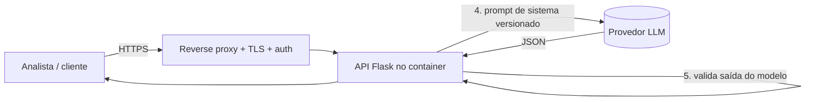

# DevSecOps AI Triage

Projeto de implantação de uma aplicação com **Inteligência Artificial** governada por um pipeline
**DevSecOps**, com **análise de vulnerabilidades**, **conformidade** (OWASP, NIST SSDF, LGPD, ISO 27001) e
**acervo de prompts versionado no GitHub**.

> Atividade de Cloud e IA — Prof. Eduardo Popovici · FIAP

## O que é a aplicação

API Flask que recebe o relato de um incidente de segurança em texto livre e devolve uma **sugestão** de
severidade, categoria, resumo e ações recomendadas, gerada por um LLM. A decisão final é sempre humana.

- **Provedor de IA plugável:** `mock` (padrão, sem custo e determinístico, ideal para CI) ou
  `openai_compatible` (OpenAI, Azure OpenAI, Ollama, vLLM...).
- **Agnóstico de cloud:** roda em qualquer host com Docker.

## Arquitetura



## Como rodar

### Local

```bash
python -m venv .venv && source .venv/bin/activate
pip install -r requirements-dev.txt
pytest                         # 22 testes, cobertura mínima 85 %
python -m app.main             # http://127.0.0.1:8000
```

### Docker

```bash
cp .env.example .env
docker compose up -d --build
curl -s localhost:8000/health
curl -s -X POST localhost:8000/triage -H 'Content-Type: application/json' \
  -d '{"text":"Funcionário clicou em link suspeito e informou a senha"}'
```

### Usando um LLM de verdade

No `.env`: `LLM_PROVIDER=openai_compatible`, `LLM_API_URL`, `LLM_API_KEY`, `LLM_MODEL`.
No GitHub, guarde a chave em **Settings → Secrets and variables → Actions**. Nunca em arquivo versionado.

## Pipeline DevSecOps

Arquivo: [`.github/workflows/devsecops.yml`](.github/workflows/devsecops.yml)

| # | Estágio | Ferramenta | Bloqueia o build quando... |
|---|---|---|---|
| 1 | Lint + testes | Ruff, pytest | Lint falha, teste falha ou cobertura < 85 % |
| 2 | Segredos | Gitleaks | Há chave/token no histórico |
| 3 | SAST | Bandit, CodeQL | Achado de severidade média ou superior |
| 4 | SCA | pip-audit | Dependência com vulnerabilidade conhecida |
| 5 | Docker / IaC | Hadolint, Trivy config | Má prática HIGH/CRITICAL |
| 6 | Imagem | Trivy + Syft (SBOM) + Cosign | CVE HIGH/CRITICAL com correção disponível |
| 7 | DAST | OWASP ZAP baseline | Alerta contra a aplicação em execução |
| 8 | Deploy | SSH + docker compose | Falta aprovação manual no environment `production` |

Além disso: **Dependabot** (pip, Docker, Actions) e **scan semanal agendado**.

## Documentação

| Documento | Conteúdo |
|---|---|
| [`docs/CONFORMIDADE.md`](docs/CONFORMIDADE.md) | Mapeamento OWASP Top 10, OWASP LLM Top 10, NIST SSDF, LGPD, ISO 27001, CIS Docker |
| [`docs/ANALISE-VULNERABILIDADES.md`](docs/ANALISE-VULNERABILIDADES.md) | STRIDE, achados reais com antes/depois, riscos residuais |
| [`docs/evidencias/`](docs/evidencias/) | Saídas brutas de pytest, Ruff, Bandit e pip-audit |
| [`docs/img/`](docs/img/) | Diagramas de arquitetura, pipeline e antes/depois (gerados por `scripts/gerar_diagramas.py`, requer `pillow`) |
| [`prompts/`](prompts/) | **Acervo de prompts** (SDLC + prompt de runtime) e registro de uso |
| [`SECURITY.md`](SECURITY.md) | Política de divulgação de vulnerabilidades |

## Resultados verificados localmente

- `pytest`: 22 testes passando, cobertura 86,7 %
- `ruff`: sem pendências
- `bandit`: 1 achado médio (B310) → mitigado → 0 achados
- `pip-audit`: `flask 3.1.2` com PYSEC-2026-2151 → atualizado para 3.1.3 → 0 vulnerabilidades
- Smoke test com gunicorn: `/health` 200, `/triage` 200, prompt injection 422, cabeçalhos de segurança presentes

**No GitHub Actions** (26/10/2026): os 8 estágios passaram depois de três correções no pipeline, descritas em
[`docs/ANALISE-VULNERABILIDADES.md`](docs/ANALISE-VULNERABILIDADES.md). O deploy não implanta nada sem os secrets `DEPLOY_*`.

## Publicando no GitHub (passo a passo)

```bash
git init -b main && git add . && git commit -m "feat: projeto DevSecOps AI Triage"
git remote add origin https://github.com/vlongo404/devsecops-ai-triage.git
git push -u origin main
```

Depois, no repositório (Settings):

1. **Code security**: ativar Dependabot alerts, Secret scanning + Push protection, Code scanning e Private vulnerability reporting.
2. **Branches**: proteger `main` exigindo PR e os checks do pipeline.
3. **Environments**: criar `production` com *Required reviewers*.

## Limitações conhecidas

Heurística de prompt injection por palavras-chave; rate limiter em memória; sem autenticação na aplicação
(delegada ao gateway); redação de PII por regex não cobre nomes próprios. Detalhes em
[`docs/ANALISE-VULNERABILIDADES.md`](docs/ANALISE-VULNERABILIDADES.md).
